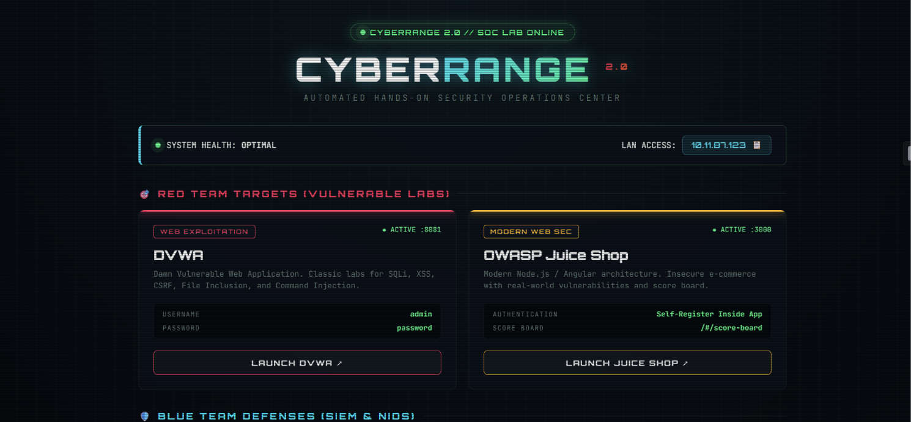
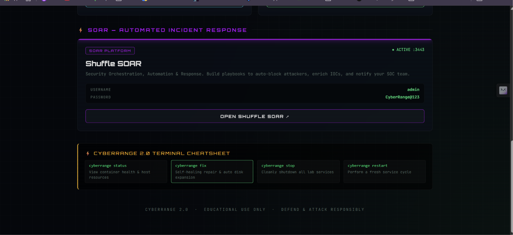
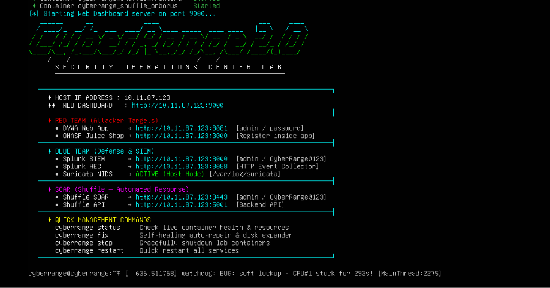

<div align="center">

```
   ______      __             ____                          ___     ____ 
  / ____/_  __/ /_  ___  ____/ __ \____ _____  ____ ____   |__ \   / __ \
 / /   / / / / __ \/ _ \/ __/ /_/ / __ `/ __ \/ __ `/ _ \  __/ /  / / / /
/ /___/ /_/ / /_/ /  __/ / / _, _/ /_/ / / / / /_/ /  __/ / __/_ / /_/ / 
\____/\__, /_.___/\___/_/ /_/ |_|\__,_/_/ /_/\__, /\___/ /____/(_)____/  
     /____/                                 /____/                       
```

# CyberRange 2.0 — SOC Lab (Elite Edition)

**Automated, Hands-On Security Operations Center Lab**

[](LICENSE)
[](#)
[](#)
[](#-download--deploy)

*A high-performance, automated SOC lab for cybersecurity training, attack simulation, and blue team detection engineering.*

---

### 📥 [Click Here to Download `Cyberrange.ovf`](cyberrange%20_docs/Cyberrange.ovf)
**Pre-Configured VMware & VirtualBox OVF Appliance** · [Manifest Checksum](cyberrange%20_docs/Cyberrange.mf)

</div>

---


*CyberRange 2.0 Web Dashboard — Red Team targets, Blue Team defenses, and SOAR in one view*


*CyberRange 2.0 Web Interface Overview*


*CyberRange 2.0 SSH Login Banner — ASCII art + live endpoints on every SSH login*

---

## 📋 Table of Contents

- [Features](#-features)
- [System Architecture](#-system-architecture)
- [VM Configuration & Requirements](#-vm-configuration--requirements)
- [Download & Deploy](#-download--deploy)
- [Installation on Existing Machine](#-installation-on-existing-machine)
- [CLI Commands](#-cli-commands-cyberrange)
- [Lab Manager — Add/Remove Labs](#-lab-manager--addremove-labs)
- [Attack Targets & Defense Tools](#-attack-targets--defense-tools)
- [Default Credentials](#-default-credentials)
- [OVA Export Guide (VMware)](#-ova-export-guide-vmware)
- [Troubleshooting & Auto-Fix](#-troubleshooting--auto-fix)
- [Optimize for Low RAM (SSH-Only)](#-optimize-for-low-ram-ssh-only)
- [Contributing](#-contributing)
- [License](#-license)

---

## ⚡ Features

| Feature | Description |
|:--------|:------------|
| 🚀 **One-Command Deploy** | `sudo ./install.sh` installs everything — Docker, firewall, CLI, MOTD |
| 🛠️ **Unified CLI** | `cyberrange start/stop/status/fix/reset/lab` from anywhere |
| 📦 **Dynamic Lab Manager** | `cyberrange lab add juice-shop` — install/remove labs on-the-fly |
| 🔧 **Self-Healing Engine** | `cyberrange fix` — auto-repairs Docker, LVM disk, logs, ports |
| ✨ **ASCII MOTD Banner** | Glowing terminal banner with live IPs and credentials on SSH login |
| 💻 **Cyberpunk Dashboard** | Web dashboard on port 9000 with neon theme, live pings, 1-click creds |
| 🔄 **Auto-Start (systemd)** | Lab starts automatically on VM boot (optional) |
| 🛡️ **Built-in Security** | UFW firewall + Fail2ban + Suricata NIDS auto-configured |
| ⚡ **SOAR Integration** | Shuffle SOAR with playbook automation built-in |
| 📊 **Memory Optimized** | All containers have memory limits — runs on 8GB RAM |

---

## 🧩 System Architecture

```
                               ┌─────────────────────────────────┐
                               │    CyberRange Host Machine      │
                               │    Ubuntu 22.04 LTS Server      │
                               │    IP: Auto-detected LAN IP     │
                               └────────────┬────────────────────┘
                                            │
           ┌────────────────────────────────┼────────────────────────────────┐
           │                                │                                │
    ┌──────┴──────┐                 ┌───────┴───────┐               ┌───────┴───────┐
    │  Port 9000  │                 │  Port 8081    │               │  Host Network │
    │  Dashboard  │                 │  DVWA Web App │               │  Suricata IDS │
    │  (Web UI)   │                 │  (Red Team)   │               │  (Sniffer)    │
    └─────────────┘                 └───────────────┘               └───────────────┘
           │                                │                                │
    ┌──────┴──────┐                 ┌───────┴───────┐               ┌───────┴───────┐
    │  Port 8000  │                 │  Port 3443    │               │  Port 5001    │
    │ Splunk SIEM │                 │  Shuffle SOAR │               │  Shuffle API  │
    │ (Blue Team) │                 │  (Web UI)     │               │  (Backend)    │
    └─────────────┘                 └───────────────┘               └───────────────┘
```

---

## 💻 VM Configuration & Requirements

| Resource | Minimum | Recommended |
|:---------|:--------|:------------|
| **RAM** | 8 GB | 12–16 GB |
| **CPU** | 2 cores | 4 cores |
| **Disk** | 40 GB | 60–80 GB |
| **Network** | Bridged Adapter | Bridged Adapter |
| **OS** | Ubuntu 22.04 Server | Ubuntu 22.04 Server |

### Container Memory Allocation (12 GB RAM Profile)

| Container | Memory Limit | Purpose |
|:----------|:-------------|:--------|
| **DVWA** | 512 MB | Vulnerable web target (PHP/MySQL) |
| **Splunk Enterprise** | 4 GB | Core SIEM log correlation & HEC ingestion |
| **Suricata NIDS** | 1 GB | Network packet inspection (Host Mode) |
| **Shuffle Database** (OpenSearch) | 1.5 GB *(1GB JVM)* | SOAR workflow database |
| **Shuffle Backend** | 1.5 GB | SOAR automation engine & API server |
| **Shuffle Frontend** | 512 MB | SOAR Web UI |
| **Shuffle Orborus** | 512 MB | SOAR worker manager |
| **Total (Containers)** | **~9.6 GB** | Leaves ~2.5 GB host RAM + 4 GB swap for OS & SSH |

> 💡 With 12 GB RAM and 60 GB disk allocated, Splunk and Shuffle OpenSearch run at peak performance with zero memory pressure. To apply this profile and purge Juice Shop, run: `sudo bash remove-juiceshop.sh`.

### Pre-Built OVA VM Configuration

| Setting | Value |
|:--------|:------|
| **Hypervisor** | VMware Workstation / VirtualBox |
| **OS** | Ubuntu 22.04 LTS |
| **Username** | `cyberrange` |
| **Password** | `cyberrange` |
| **Network** | Bridged (auto-detects LAN IP) |
| **SSH** | Enabled (port 22) |
| **Auto-Start** | CyberRange starts on boot |

---

## 📥 Download & Deploy

### Option 1: Direct OVF Template (Fastest — In Repo)

The pre-configured Open Virtualization Format (OVF) descriptor and manifest are included directly in this repository:

1. **Download**:
   - 📄 [**`Cyberrange.ovf`**](cyberrange%20_docs/Cyberrange.ovf) (Virtual Machine Definition)
   - 📜 [**`Cyberrange.mf`**](cyberrange%20_docs/Cyberrange.mf) (SHA Manifest)
2. **Import** into your hypervisor:
   - **VMware Workstation**: `File → Open` → select `Cyberrange.ovf`
   - **VirtualBox**: `File → Import Appliance` → select `Cyberrange.ovf`
3. Configure RAM (8 GB minimum, 12–16 GB recommended) and set Network to **Bridged Adapter**.
4. Power on the VM, SSH in:
   ```bash
   ssh cyberrange@<VM_IP>
   # Default password: cyberrange
   ```
5. Open your web dashboard: `http://<VM_IP>:9000`

---

### Option 2: Pre-Built Standalone OVA Appliance

For a single standalone `.ova` virtual appliance containing the full pre-installed disk image:

1. **Download**: [📦 **CyberRange 2.0 Standalone OVA**](https://github.com/SumitNayak1337/CyberRange/releases) *(Available on GitHub Releases)*
2. **Import** directly into VMware Workstation or VirtualBox:
   - VMware: `File → Open → CyberRange-2.0.ova`
   - VirtualBox: `File → Import Appliance → CyberRange-2.0.ova`
3. **Adjust RAM** (minimum 8 GB, 12 GB+ recommended)
4. **Set Network Adapter** to **Bridged Adapter**
5. **Power On** the VM
6. **SSH In**:
   ```bash
   ssh cyberrange@<VM_IP>
   # Password: cyberrange
   ```
7. Lab auto-starts! Open dashboard: `http://<VM_IP>:9000`

---

### Option 3: Deploy on Any Existing Ubuntu 22.04 LTS Machine

```bash
# Clone the repository
git clone https://github.com/SumitNayak1337/CyberRange.git
cd CyberRange/Cyberrange_Programfiles

# Run the master installer (installs Docker, CLI, firewall, MOTD, systemd)
sudo ./install.sh

# (Optional) Optimize for SSH-only mode (removes GUI, sets up swap)
sudo cyberrange optimize
```

---

## ⚡ CLI Commands (`cyberrange`)

After installation, the `cyberrange` command is available globally:

| Command | Description |
|:--------|:------------|
| `cyberrange start` | Launch all containers + dashboard + web server |
| `cyberrange stop` | Gracefully stop all services |
| `cyberrange restart` | Clean restart cycle |
| `cyberrange status` | Live container health, RAM, disk metrics |
| `cyberrange fix` | Auto-repair Docker, expand disk, clean logs, fix ports |
| `cyberrange reset` | Wipe all data/volumes and restart fresh |
| `cyberrange lab list` | Show available & installed labs |
| `cyberrange lab add <name>` | Install a new vulnerable lab |
| `cyberrange lab remove <name>` | Remove a lab and clean up its image |
| `cyberrange optimize` | Remove GUI, setup swap, clean bloat (SSH-only) |
| `cyberrange banner` | Display the ASCII splash screen |
| `cyberrange autostart enable` | Start lab on VM boot |
| `cyberrange autostart disable` | Disable auto-start on boot |

---

## 📦 Lab Manager — Add/Remove Labs

CyberRange 2.0 includes a dynamic lab manager. Add or remove vulnerable labs without manually editing config files:

```bash
# See all available labs
cyberrange lab list

# Add OWASP Juice Shop
cyberrange lab add juice-shop

# Add OWASP WebGoat
cyberrange lab add webgoat

# Remove a lab (stops container + deletes image)
cyberrange lab remove juice-shop
```

### Available Lab Catalog

| Lab | Type | Port | RAM | Description |
|:----|:-----|:-----|:----|:------------|
| `juice-shop` | 🔴 Red Team | 3000 | 512 MB | OWASP Juice Shop — Modern web security |
| `webgoat` | 🔴 Red Team | 8080 | 512 MB | OWASP WebGoat — Interactive lessons |
| `hackazon` | 🔴 Red Team | 8085 | 256 MB | Hackazon — Vulnerable e-commerce |
| `mutillidae` | 🔴 Red Team | 8086 | 256 MB | OWASP Mutillidae II |
| `bwapp` | 🔴 Red Team | 8087 | 256 MB | bWAPP — Buggy Web App |
| `wazuh` | 🔵 Blue Team | 1514 | 1 GB | Wazuh SIEM — Security monitoring |
| `thehive` | 🔵 Blue Team | 9001 | 1 GB | TheHive — Incident response |

> 💡 **Core services (DVWA, Splunk, Suricata, Shuffle) are always present and cannot be removed.**

---

## 🎯 Attack Targets & Defense Tools

### 🔴 Red Team (Offensive)

| Target | URL | Description |
|:-------|:----|:------------|
| **DVWA** | `http://<IP>:8081` | SQL Injection, XSS, CSRF, File Inclusion, Command Injection |
| *+ Addon Labs* | *Various ports* | Add more via `cyberrange lab add <name>` |

### 🔵 Blue Team (Defensive)

| Tool | URL | Description |
|:-----|:----|:------------|
| **Splunk Enterprise** | `http://<IP>:8000` | SIEM — Log aggregation, correlation, SOC rules |
| **Splunk HEC** | `http://<IP>:8088` | HTTP Event Collector for real-time log ingestion |
| **Suricata NIDS** | Host Network | Deep Packet Inspection & intrusion detection |

### ⚡ SOAR (Automation)

| Tool | URL | Description |
|:-----|:----|:------------|
| **Shuffle SOAR** | `http://<IP>:3443` | Playbook automation — auto-block, ticket, enrich IOCs |
| **Shuffle API** | `http://<IP>:5001` | Backend API for workflow automation |

---

## 🔐 Default Credentials

| Service | Username | Password |
|:--------|:---------|:---------|
| **VM SSH** | `cyberrange` | `cyberrange` |
| **DVWA** | `admin` | `password` |
| **Splunk** | `admin` | `CyberRange@123` |
| **Shuffle SOAR** | `admin` | `CyberRange@123` |
| **Shuffle API Key** | — | `cyberrange-shuffle-api-key-2024` |
| **Dashboard** | — | *No auth required* |

---

## 📦 OVA Export Guide (VMware)

To share this VM as an `.ova` file that anyone can import:

### Method 1: VMware Workstation (GUI)

1. **Shut down** the VM completely (`sudo shutdown -h now`)
2. In VMware: `File → Export to OVF/OVA...`
3. Choose **OVA** format (single file, easier to share)
4. Select destination folder
5. Click **Export**
6. Wait for export to complete (may take 10-30 minutes depending on disk size)

### Method 2: Using OVFTool (Command Line)

```powershell
# Install OVFTool (comes with VMware Workstation)
# Default location: C:\Program Files (x86)\VMware\VMware Workstation\OVFTool\

# Navigate to OVFTool
cd "C:\Program Files (x86)\VMware\VMware Workstation\OVFTool"

# Export VMX to OVA
.\ovftool.exe "D:\Virtual Machines\CyberRange\CyberRange.vmx" "D:\CyberRange-2.0.ova"
```

> Replace the paths with your actual VM location.

### Method 3: VirtualBox

```bash
# List VMs
VBoxManage list vms

# Export to OVA
VBoxManage export "CyberRange" -o CyberRange-2.0.ova
```

### Before Exporting — Shrink the OVA Size

SSH into the VM and run these commands to minimize the OVA file size:

```bash
# 1. Clean up the machine
sudo cyberrange optimize

# 2. Clean package caches
sudo apt-get clean && sudo apt-get autoremove -y

# 3. Zero-fill free space (helps compression)
sudo dd if=/dev/zero of=/zero.fill bs=1M 2>/dev/null || true
sudo rm -f /zero.fill

# 4. Truncate Docker logs
sudo sh -c 'truncate -s 0 /var/lib/docker/containers/*/*-json.log'

# 5. Clear bash history
history -c && cat /dev/null > ~/.bash_history

# 6. Shutdown
sudo shutdown -h now
```

Then export from VMware/VirtualBox.

### Importing on Another Machine

1. Download the `.ova` file
2. **VMware**: `File → Open` → Select `.ova` → `Import`
3. **VirtualBox**: `File → Import Appliance` → Select `.ova`
4. Adjust RAM (minimum 8 GB, recommended 12+ GB)
5. Set network to **Bridged Adapter**
6. Boot and SSH: `ssh cyberrange@<NEW_IP>`

---

## 🔧 Troubleshooting & Auto-Fix

```bash
cyberrange fix
```

This auto-repairs:
- ✅ Docker Engine health — restarts daemon if frozen
- ✅ LVM disk expansion — claims 100% free space
- ✅ Docker log de-bloat — truncates runaway logs
- ✅ Port conflicts — clears zombie processes
- ✅ Suricata permissions — restores log directory access
- ✅ Dashboard re-bind — detects new IP and regenerates

### Common Issues

| Problem | Solution |
|:--------|:---------|
| Containers not starting | `cyberrange fix` then `cyberrange restart` |
| Out of disk space | `cyberrange fix` (auto-expands LVM + prunes Docker) |
| Shuffle database not loading | `sudo chown -R 1000:1000 shuffle-database` then restart |
| Splunk web not loading | Wait 2-3 minutes after start (Splunk takes time to boot) |
| High RAM usage | Run `cyberrange optimize` to remove GUI + set up swap |
| Dashboard shows wrong IP | `cyberrange restart` (re-detects IP) |
| VM freezing / lagging | Increase RAM to 12-16 GB or run in SSH-only mode |

---

## 🚀 Optimize for Low RAM (SSH-Only)

If you have an 8GB RAM host machine or want to maximize performance, CyberRange 2.0 includes a dedicated optimization tool that strips out desktop GUI overhead, removes snap bloat, creates a 4GB swapfile, and tunes the Linux kernel:

```bash
# Run the built-in optimizer
sudo cyberrange optimize
```

### What `cyberrange optimize` does:
1. **Configures 4GB Swap**: Ensures your VM never crashes from out-of-memory (OOM) killer.
2. **Swappiness Tuning**: Sets `vm.swappiness=10` so Linux only swaps under real memory pressure.
3. **Disables GUI Desktop**: Frees up 1.5–2.5 GB of RAM by switching to multi-user (headless) target.
4. **Purges Unused Packages**: Removes snapd, unattended-upgrades, and redundant background daemons.
5. **Docker Memory Limits**: Caps each container's RAM usage so no single container starves the system.

---

## 🤝 Contributing

Contributions welcome! Submit PRs for:
- New vulnerable labs (Active Directory, Cloud security labs)
- New Blue Team tools (Wazuh, Zeek, Elastic, MISP)
- Threat simulation scripts (Caldera, Atomic Red Team)
- Dashboard improvements
- Documentation

---

## ⚠️ Disclaimer

**CYBERRANGE · EDUCATIONAL USE ONLY · ISOLATED LAB ENVIRONMENT**

This lab contains intentionally vulnerable software. Run it exclusively in isolated networks or virtualized environments. Never expose these ports to public networks without proper authentication and firewalling.

---

## 📄 License

This project is licensed under the MIT License — see the [LICENSE](LICENSE) file for details.

---

<div align="center">

**Made with 🛡️ for the cybersecurity community**

`DEFEND & ATTACK RESPONSIBLY`

</div>
